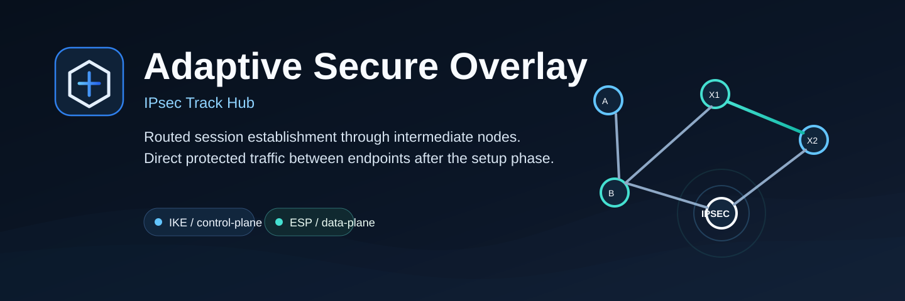

# Adaptive Secure Overlay



[](README.md)
[](README.ru.md)
[](core/README.md)
[](core/)

**Adaptive Secure Overlay** is the unified open repository containing both the **protocol/control-plane core** and **per-OS platform implementations** developed as part of doctoral research in information security (adaptive IPsec/IKE overlay routing and multi-platform secure channel establishment).

## Core Principle

1. **Routed control-plane:** IKE / key-exchange negotiation can traverse selected intermediate overlay nodes (`X1` / `X2`) instead of exposing a direct signaling path.
2. **Direct encrypted data-plane:** Once security associations (SAs) are established, protected traffic (ESP) flows directly between endpoints.
3. **Role-limited route awareness:** Each intermediate node sees only the hop metadata required for its role.

## Repository Structure (Core Separate from Platforms)

```text
adaptive-ipsec-overlay/
├── core/                      # Shared protocol & routed control-plane core (Python)
├── platforms/
│   ├── linux/                 # Debian/Ubuntu endpoint & relay installer (strongSwan, nftables, XFRM, systemd)
│   ├── openwrt/               # OpenWRT router endpoint & relay installer (init.d, nftables, strongSwan)
│   ├── routeros7/             # MikroTik RouterOS 7 container intermediate relay profile
│   ├── windows/               # Windows native service, CLI & manual-SA / WFP prototype (C# / .NET 8)
│   └── android/               # Android Jetpack Compose client + Rust JNI/NDK native-core (Kotlin + Rust)
├── scripts/                   # Shared nftables/iptables/XFRM helper scripts & release packaging
├── examples/                  # Sample lab topologies and node configs
└── docs/                      # Architecture and compatibility research notes
```

## Platform Status & Tech Stack

| Component | Path | Stack | Status |
| --- | --- | --- | --- |
| **Control-Plane Core** | [`core/`](core/) | Python | Active baseline (routed IKE proxy & daemon) |
| **Linux Endpoint / Relay** | [`platforms/linux/`](platforms/linux/) | Bash, strongSwan, nftables, systemd | Working lab baseline |
| **OpenWRT Router** | [`platforms/openwrt/`](platforms/openwrt/) | Bash, procd/init.d, strongSwan, nftables | Working lab baseline |
| **MikroTik RouterOS 7** | [`platforms/routeros7/`](platforms/routeros7/) | RouterOS `.rsc`, OCI container | Intermediate relay profile |
| **Windows Native Client** | [`platforms/windows/`](platforms/windows/) | C# / .NET 8, DPAPI, X25519/HKDF, WFP | Prototype + manual-SA proof |
| **Android Mobile Client** | [`platforms/android/`](platforms/android/) | Kotlin, Jetpack Compose, **Rust (`native-core` JNI/NDK)** | Prototype + emulator JNI self-test proof |

## Quick Start

- **Linux / OpenWRT / RouterOS 7:** see [`platforms/linux/`](platforms/linux/README.md), [`platforms/openwrt/`](platforms/openwrt/README.md), [`platforms/routeros7/`](platforms/routeros7/README.md).
- **Windows (.NET):** `dotnet build platforms/windows/adaptive-client/AdaptiveClient.Core/AdaptiveClient.Core.csproj`.
- **Android (Kotlin + Rust JNI):** see [`platforms/android/README.md`](platforms/android/README.md) and [`platforms/android/native-core/`](platforms/android/native-core/README.md).

## Security Note

Sample files under `examples/` contain lab-only placeholder secrets. Never commit real production keys or credentials.
