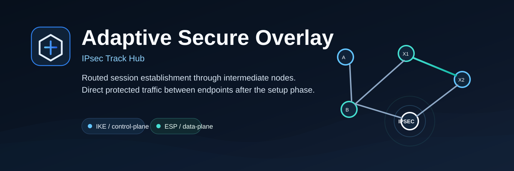

# Adaptive Secure Overlay



[](README.md)
[](README.ru.md)
[](core/README.md)

**Adaptive Secure Overlay** — единый открытый репозиторий с **общим ядром (`core/`)** и **отдельными реализациями под каждую ОС (`platforms/`)**, выполненный в рамках кандидатского исследования по информационной безопасности (маршрутизируемый control-plane для адаптивного установления защищенных IPsec-каналов).

## Архитектурная идея

1. **Маршрутизируемый control-plane:** обмен параметрами IKE / установления сессии идет через выбранные промежуточные узлы (`X1` / `X2`), а не напрямую.
2. **Прямой защищенный data-plane:** после согласования ключей (SA) рабочий трафик (ESP) передается напрямую между конечными узлами.
3. **Разделение осведомленности:** транзитный узел получает только минимальный фрагмент маршрутных сведений, необходимый для пересылки своего шага.

## Структура проекта (ядро отдельно, платформы отдельно)

```text
adaptive-ipsec-overlay/
├── core/                      # Общее ядро протокола и маршрутизируемого control-plane (Python)
├── platforms/
│   ├── linux/                 # Профиль конечного и промежуточного узла для Debian/Ubuntu (strongSwan, nftables, XFRM, systemd)
│   ├── openwrt/               # Профиль для роутеров OpenWRT (init.d, nftables, strongSwan)
│   ├── routeros7/             # Контейнерный профиль транзитного узла для MikroTik RouterOS 7
│   ├── windows/               # Нативная служба, CLI и WFP/manual-SA прототип под Windows (C# / .NET 8)
│   └── android/               # Мобильный клиент на Kotlin + криптоядро на Rust через JNI/NDK
├── scripts/                   # Общие скрипты nftables/iptables/XFRM и сборка tar.gz пакета
├── examples/                  # Шаблоны лабораторных конфигураций
└── docs/                      # Архитектурные заметки и совместимость с WireGuard
```

## Модули и стек

| Модуль | Каталог | Стек | Статус |
| --- | --- | --- | --- |
| **Общее ядро** | [`core/`](core/) | Python | Рабочая лабораторная база |
| **Linux** | [`platforms/linux/`](platforms/linux/) | Bash, strongSwan, nftables, systemd | Рабочий стендовый профиль |
| **OpenWRT** | [`platforms/openwrt/`](platforms/openwrt/) | Bash, init.d, strongSwan, nftables | Рабочий стендовый профиль |
| **MikroTik RouterOS 7** | [`platforms/routeros7/`](platforms/routeros7/) | RouterOS `.rsc`, OCI container | Профиль промежуточного узла |
| **Windows** | [`platforms/windows/`](platforms/windows/) | C# / .NET 8, DPAPI, X25519/HKDF, WFP | Прототип службы + проверка manual-SA |
| **Android** | [`platforms/android/`](platforms/android/) | Kotlin, Jetpack Compose, **Rust (`native-core` JNI/NDK)** | Прототип + проверка JNI в эмуляторе |

## Примечание по безопасности

В каталоге `examples/` приведены только тестовые лабораторные конфигурации. Не публикуйте реальные рабочие ключи и учетные данные.
