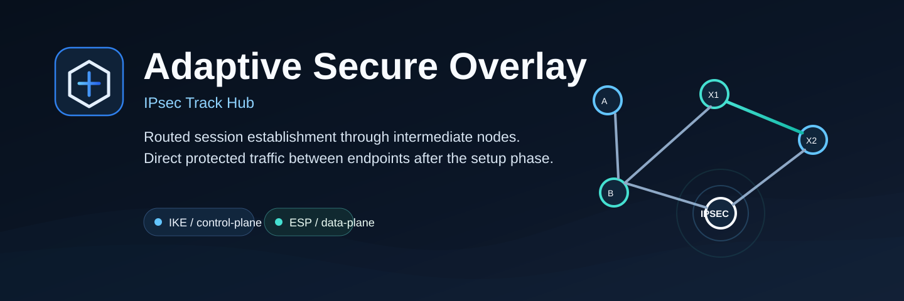

# Adaptive Secure Overlay — Windows Client & Service



Windows endpoint implementation for Adaptive Secure Overlay (`platforms/windows`), built with C#/.NET (`AdaptiveClient.Core`, `AdaptiveClient.Service`, `AdaptiveClient.Cli`) and Windows Filtering Platform / manual-SA integration.

See also: [STATUS.md](STATUS.md) and [docs/current-status.md](docs/current-status.md).

## Achieved so far

- Windows EXE service and CLI skeleton for the Adaptive Secure Overlay flow
- AIKE-style dry-run path with X25519, HKDF and signed envelope plumbing
- DPAPI-backed local identity handling in the service layer
- Manual-SA planning, validation and local install orchestration
- Encrypted peer-install envelope flow for service-to-service dry-run exchange
- Regression, checkpoint and live-gate automation (`adaptive-client/run-windows-exe-regression.ps1`)
- Local proof that Windows accepts manually installed ESP SAs through WFP/IPsec APIs

## Not finished yet

- Release-grade installer and tray application
- Stable end-to-end host-to-host Windows ESP flow packaged for one-click deployment
- Production-grade peer deployment and code signing

## Quick start

```powershell
dotnet build .\adaptive-client\AdaptiveClient.Core\AdaptiveClient.Core.csproj --no-restore
dotnet build .\adaptive-client\AdaptiveClient.Service\AdaptiveClient.Service.csproj --no-restore
dotnet build .\adaptive-client\AdaptiveClient.Cli\AdaptiveClient.Cli.csproj --no-restore
.\adaptive-client\run-windows-exe-regression.ps1 -Quick
```
